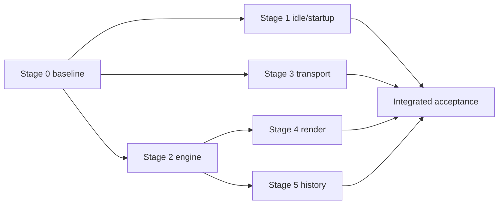
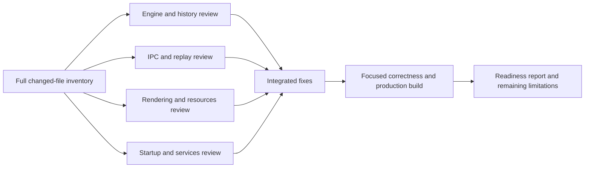

# Harness performance rebuild — execution record

Specification: `/Users/rcourson/.claude/plans/look-at-this-plan-sorted-anchor.md`.
Starting commit: `3fd9cf174215808af8721eb8a687b75f16514339`, clean checkout.
Local execution only; no release/deployment/push. Apple M5 Max, Xcode 27.0.

Engine interfaces precede render integration. Typed host events precede idle acceptance.
Builds and native measurements have one exclusive slot owned by the integrator.

| Node | Requirements | Owner | State/evidence |
|---|---|---|---|
| B | Fresh HEAD engine baseline, pre-generated DSR probes, recorded agent UI, idle and styled scale | Integrator | Complete: 76 release records; ASCII/SGR/Unicode 1 warm-up +5 samples; 1/10/30/50 panes, ten actual idle Codex TUIs at 50; shared-clock warm reconnect |
| S | Trusted helper stamp/deferred refresh, readiness/attach, shared observations, settings watchers/cache, deadlines, revision checkpoints, render backoff, worker parser/visibility QoS | Services + transport + integrator | Implemented; full/focused checks pass. Fifty-pane owned idle 1.033% of one core. Warm prompt submission median 296.31 ms; diagnostic and final receipts recorded |
| E | Pointer history/canonical words, ring metadata/bitset damage, masked ring, concrete parser, SGR profiling | Engine | Implemented; differential/correctness checks pass. ASCII 162.03 MB/s, scroll 184.18 MB/s, SGR 161.25 MB/s; gains 3.68×/3.88×/2.91× |
| T | Read batching, event sources, direct ingress, segmented writes, typed events, bounded backpressure/resync | Transport + integrator | Implemented; real 16 MiB PTY pressure test proves mandatory consumer minimum fence; 40 MiB replay ordering and typed event/window tests pass |
| R | Dirty-row mirror/direct GPU instances, serial off-main encoding, resize exception, overlays | Integrator + services | Implemented; renderer/cursor pixel parity and 35 final resize/lifecycle checks pass; layer identity and bounded acquisition lanes validated |
| H | Lossless packed styled history, block styles/sparse metadata, raw compressed blocks/hot tail | Engine + transport | Implemented; concurrent snapshots/differential reflow/search/eviction pass. Thirty-pane owned memory 35.5% lower, fifty 46.0% lower; one-pane memory regresses |
| A | Receipts, full/focused correctness, native smoke, Swift/Linux/Xcode gates, scorecard | Integrator | Swift 2,387 unique passes, 63 intentional skips; final 16 IPC/startup checks pass; final macOS release/Xcode pass. Linux release/dependency gate passes; native echo and UI/CLI smoke complete, receipts recorded |

Numeric outcomes are reported individually in the [final report](benchmarks/performance-rebuild-2026-10-10.md). Missed targets remain visible; implementation completion does not imply all targets passed. No durable format change or migrator;
one coordinated runtime protocol bump. Remove obsolete switches. Preserve appearance,
workflows, encryption, Linux/shared mobile consumers. Worker changes use disjoint ownership;
no shared builds without the exclusive slot. Missing evidence remains incomplete.

## Production-readiness audit — October 10

User authorized a thorough review and fixes across the entire local change, with no release.
Audit input is the final measured working tree identified by source receipt
`59285da821de96f23043dba9979401881361c9cee4728ca857940af758ecbada`.
The benchmark record remains historical evidence; fixes require their own verification.

| Lane | Owner and exclusive files | State / acceptance |
|---|---|---|
| Engine/history | Engine reviewer: ParkedRing and its test; other engine files read-only | Audit all engine changes; fix quadratic block eviction; lossless order and bounded retention |
| Transport | Transport reviewer: DaemonObservationCheckpoint, DaemonClient, TerminalHostView, SurfaceOutputReceiver and related tests | Fix mandatory ACK accumulation and replay reconnect fences; prove no stalls, gaps or duplication |
| Render | Render reviewer: HarnessTerminalSurfaceView and affected existing Kit tests; other renderer files read-only | Fix stale blink/frame ordering; assess graphics-memory regression and resource lifetime |
| Services/integration | Root: all remaining files, shared metadata/docs/project, test/build/native slot | Audit every remaining change; fix watcher, exit-state and service deadline issues; verify integrated candidate |

Root is the only shared build/test/profile/native-runtime owner. Reviewers may edit only their
reserved files and return narrow proposals for shared seams. No push, release, Actions or cloud
dispatch. Existing normal Harness sessions must remain untouched. Reuse unaffected tests and
measurements; rerun only changed dependencies and final necessary build gates. Readiness is
not accepted while a concrete correctness defect or unexplained regression remains open.

Audit completion: concrete findings fixed; 106 distinct focused tests pass, final macOS
release and Xcode builds pass, Linux ARM64 release/dependency gate passes. Native
search/split/Unicode/zoom/settings/reconnect smoke passes. The large one-pane memory
regression did not reproduce: matched post-workload owned samples are 119.27/120.08 MiB
and styled-history samples 118.89/120.28 MiB (baseline/candidate). The transient graphics
allocation occurred in both; no speculative renderer change was made to explain it.
Source receipt: `8b47956cd11a2a79ad9050c2c5fa6e1205a846b07e579401b6c97126e8804b82`.
See the [audit report](benchmarks/production-readiness-2026-10-10.md) for repaired defects,
resolved failed attempts, native observations, and remaining signed/remote qualification
limits. Local review is complete; release certification remains outside this task.
