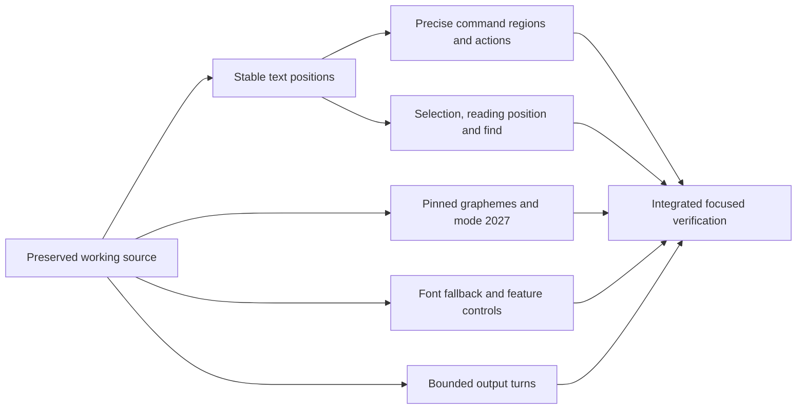

# Terminal quality implementation — 2026-10-10

Authorized: implement all five terminal quality improvements, retaining appearance and workflows. No release or publishing. Earlier dirty work preserved in `/tmp/harness-qol-baseline/{tracked.patch,untracked.tar}`; HEAD alone is not the baseline.

| Outcome | Owner / reservation | State | Acceptance |
|---|---|---|---|
| POS | Engine screen and anchor types | Verified with one known corner | Anchors follow reflow, wide glyphs, height changes and history; eviction invalidates safely. Alternate-screen shrink blanks a wide glyph cut at the margin (AlternateScreenWideResizeTests). Copy and capture share one wide-deferral rule (WideWrapCopyTests). Open: an erase of exactly the last column before a deferred wide glyph is dropped, which needs a per-row deferral flag |
| CMD | Emulator semantic regions, shell scripts and actions | Verified | Copy precise command/output, navigate failures, search command output |
| UNI | Pinned Unicode data, segmentation, capture and overlays | Verified | Official segmentation corpus, engine feed/run parity, 2027 set/reset/query, composed-text frame parity |
| FONT | Font resolver/rasterizer/settings | Verified with two optional-font skips | Defaults preserved; fallback and feature configuration reaches rendering |
| LOAD | Output receiver | Verified | Strict byte/packet work bound, FIFO, final-fragment acknowledgment |
| UI | Surface selection/scroll/find | Verified | Text and selected find result survive resize; anchor creation does not wait on the parser queue |
| CHECK | Integrator, exclusive shared build | Verified: focused tests and optimized macOS build | See [verification record](terminal-quality-2026-10-10/README.md) for evidence and limits |

One writer per area. Shared screen belongs to anchor worker until handoff; Unicode screen patch applied afterward. Surface has explicitly disjoint font and interaction edits. Shared SwiftPM/Xcode builds run only by integrator. Reuse earlier performance receipts only for unchanged behavior. Tests cover new correctness contracts; no broad benchmark rerun or unsupported comparative speed claims.
